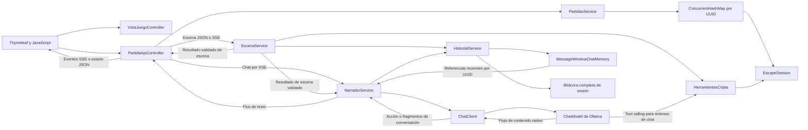

# Arquitectura y flujos

## Capas de la aplicación

- `config` publica un repositorio de memoria y una ventana Spring AI de 20 mensajes. `application.yml` incluye `ollama` y desactiva los embeddings. `application-ollama.yml` conecta con `qwen3:8b` en `http://127.0.0.1:11434`. La variable `OLLAMA_MODEL` permite elegir el modelo local.
- `controller` sirve las pantallas Thymeleaf y valida las solicitudes del navegador. Los endpoints de juego traducen sus resultados a JSON o SSE.
- `service` gestiona las sesiones por UUID, coordina las acciones de escena y la narración, y escribe los mensajes en las dos memorias.
- `tools` expone las operaciones del juego a Spring AI. Una instancia recibe la sesión y permite ejecutar una operación por turno. Las herramientas de escena devuelven su resultado directamente mediante `returnDirect`. Java conserva la validación de intentos.
- `model` aplica las reglas y guarda las fases de las tres runas de Spring AI, los sellos completados, el inventario y la selección. También genera las pistas y el diagnóstico en ES o EN.

La sesión registra si el jugador ha revelado la primera inscripción de la runa activa. Examinar el altar o el órgano y aplicar la estaca al candelabro revelan la inscripción correspondiente. Java valida cada elección, avanza a la fase siguiente y reinicia el descubrimiento al abrir otra runa. Una opción incorrecta conserva la fase y envía `runaFallida` en el evento SSE de escena.
- `dto` contiene las instantáneas de estado y los resultados que consume el cliente. `exception` define el error HTTP 404 para sesiones desconocidas.

## Flujo de un turno

1. El navegador crea una sesión con el idioma elegido. El servidor asigna un UUID y entrega una instantánea inicial de la cripta. Reiniciar crea otra sesión y conserva la partida anterior para consultar su bitácora.
2. Una interacción de escena lleva un tipo y sus argumentos. Java ejecuta la regla una vez y publica el resultado validado en `escena`. La vista aplica la instantánea y añade la reacción del entorno. La misma acción produce un único bloque de texto verificado. El endpoint de escena síncrona ejecuta la misma regla y devuelve JSON.
3. Ollama interpreta órdenes explícitas con herramientas de escena y genera las respuestas de conversación sin herramientas. Recibe los conceptos del reto, un resumen de los intentos sin avance y la consulta con las etiquetas de opciones ocultas. Java conserva las alternativas, verifica los intentos y resuelve `/diagnostico`.
4. El controlador emite `escena` al ejecutarse una acción y publica la narración en eventos SSE `texto`. El evento final `estado` incluye el resultado validado, con la pista y el informe de cierre si proceden. La escena puede recuperar la instantánea mediante `GET /api/partidas/{sessionId}/estado`.
5. La bitácora guarda el mensaje escrito o la descripción de la acción y la respuesta del narrador. Al completar las tres runas y reunir todas las reliquias, el motor genera el diagnóstico breve. La API ofrece el informe extenso bajo demanda.

## Streaming del chat

1. `ChatClient.prompt().stream().content()` entrega un `Flux<String>`. El narrador acumula los fragmentos de cada frase, revisa el texto y publica hasta tres frases aprobadas antes de que termine el flujo del modelo. La herramienta de retorno directo evita una generación posterior a la acción.
2. El controlador consume el `Flux<String>` del turno en un hilo virtual y emite un evento SSE `texto` por fragmento. Las respuestas mecánicas se dividen en grupos breves de palabras con una pausa de 45 ms entre fragmentos.
3. `fetch` conserva abierta la respuesta del POST. `TextDecoderStream` decodifica UTF-8 entre lecturas. El lector retiene únicamente el final de un evento SSE todavía incompleto, invoca el manejador para cada evento completo y actualiza `textContent` de la burbuja antes de solicitar la siguiente lectura. `estado` confirma el resultado y cierra el turno.

Referencia de la API de streaming y sus advisors. [Chat Client de Spring AI 2.0](https://docs.spring.io/spring-ai/reference/2.0/api/chatclient.html) · [Memoria de chat](https://docs.spring.io/spring-ai/reference/2.0/api/chat-memory.html)

El controlador usa un `SseEmitter` por turno con un tiempo de espera de 120 segundos y ejecuta la narración en un hilo virtual. El narrador admite hasta 90 segundos entre fragmentos del proveedor. Si el cliente cierra la conexión, el servidor deja de emitir al navegador. El cliente puede volver a consultar el estado y el historial por UUID.

## Concurrencia y retención

El mapa concurrente permite obtener o crear partidas de forma independiente. Cada sesión serializa sus turnos de chat, escena y cambio de idioma. El modelo sincroniza las operaciones de estado y entrega colecciones inmutables en la instantánea. El cerrojo de turno es independiente del cerrojo del motor para que una herramienta pueda ejecutarse desde el hilo del modelo mientras el turno sigue abierto.

La bitácora completa usa `CopyOnWriteArrayList<MensajeHistorial>`. Cada entrada se registra también en `MessageWindowChatMemory` con el UUID de la partida y el respaldo de `InMemoryChatMemoryRepository`. `HistorialService` registra el mensaje del jugador y la respuesta final visible una sola vez. Si la pregunta es una aclaración, Java toma de la ventana una pregunta reciente y oculta sus etiquetas antes de enviarla a Ollama. El filtro usa las respuestas previas para descartar repeticiones literales. Las sesiones, las bitácoras y las ventanas residen en la memoria del proceso.

## Integración de la escena

Spring MVC sirve `inicio.html` y `juego.html` mediante Thymeleaf. La portada procede del paquete `.codex-context/cripta-nocturnia-prototipo/`. La pantalla jugable conserva el SVG, los estilos y la disposición adaptable de `.codex-context/index.html`. Los identificadores `altar`, `organ`, `chandelier` y `chest` enlazan los objetos de la escena con el motor. Al pulsarlos, el navegador envía una inspección, recoge el cáliz del cofre cerrado o aplica la reliquia seleccionada.

`cripta.js` usa `fetch` para enviar JSON por POST y lee el cuerpo SSE con `ReadableStream`. Los eventos `escena` y `estado` sincronizan el avance, el inventario y los objetos. El navegador construye las respuestas mientras llegan los eventos `texto`. Tras crear o reiniciar una sesión, abre el flujo `/bienvenida` y el servidor registra la introducción en el historial y la memoria. Si se interrumpe un flujo de chat, JavaScript consulta `/estado` para recuperar la instantánea. El botón ES/EN envía un `PATCH` sobre la sesión activa. La bitácora carga el historial y descarga un `.txt` mediante `Blob`. Al finalizar, la tarjeta presenta el Diagnóstico de Arquitectura Spring AI resumido. El botón de la tarjeta solicita la versión extensa o resumida mediante `/diagnostico/stream`.
