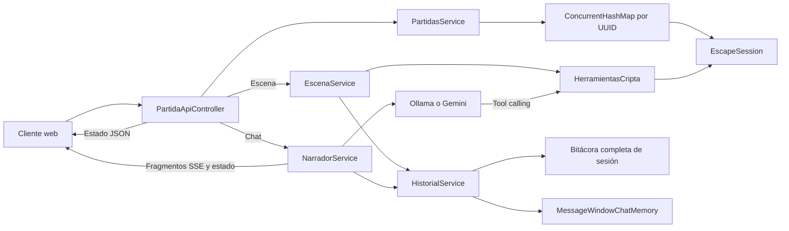

# Arquitectura y flujos

## Capas de la Fase 1

- `config` publica un repositorio de memoria y una ventana Spring AI de 20 mensajes. Los perfiles de `application.yaml`, `application-ollama.yaml` y `application-gemini.yaml` seleccionan el modelo.
- `controller` valida solicitudes y traduce resultados a JSON o SSE. Las acciones de escena regresan con una instantánea del estado.
- `service` gestiona las sesiones por UUID, coordina las acciones de escena y la narración, y escribe los mensajes en las dos memorias.
- `tools` expone las operaciones del juego a Spring AI. Una instancia recibe la sesión de la petición desde Java y permite ejecutar una sola operación por turno. El modelo recibe argumentos de juego y el resultado narrativo de la operación.
- `model` aplica las reglas y guarda la vitalidad, los sellos, el inventario, la selección y las visitas. También genera el diagnóstico de forma determinista en ES o EN.
- `dto` contiene las instantáneas de estado y los resultados que consume el cliente. `exception` define el error HTTP 404 para sesiones desconocidas.

## Flujo de un turno

1. La escena envía una acción estructurada. El controlador resuelve el UUID, valida la solicitud y ejecuta la regla sobre la sesión.
2. El chat recupera los mensajes recientes y añade el estado público al contexto. En modo de consulta, el modelo recibe el mensaje sin herramientas. Una acción explícita puede habilitar herramientas sobre esa sesión.
3. El motor devuelve el texto validado y el estado. Un sello futuro permanece bloqueado hasta resolver el anterior. El estado incluye pistas e informe cuando corresponde.
4. La escena recibe el resultado como JSON. El chat recibe eventos `texto` y un último evento `estado`. La aplicación guarda en orden lo que escribió el jugador y la respuesta del narrador.

## Concurrencia y retención

El mapa concurrente permite obtener o crear partidas de forma independiente. Cada sesión serializa sus turnos de chat, escena y cambio de idioma. El modelo sincroniza las operaciones de estado y entrega colecciones inmutables en la instantánea. El cerrojo de turno es independiente del cerrojo del motor para que una herramienta pueda ejecutarse desde el hilo del modelo mientras el turno sigue abierto.

La bitácora completa usa `CopyOnWriteArrayList<MensajeHistorial>`. Bajo el cerrojo de la sesión, cada mensaje se añade también a `MessageWindowChatMemory` por UUID, con `InMemoryChatMemoryRepository`. La ventana aporta contexto acotado al modelo. Los mensajes internos de herramientas se gestionan dentro de Spring AI. La aplicación conserva todas las partidas durante la vida del proceso. Un reinicio elimina el estado y ambas memorias.

## Integración prevista de la escena

El prototipo de `.codex-context/cripta-nocturnia-prototipo/` contiene la portada, la vista de juego, CSS, JS y los recursos gráficos. La fase de interfaz incorporará Thymeleaf, las reacciones visuales, la lectura de SSE con `fetch` y la descarga de la bitácora. Los identificadores `altar`, `organ`, `chandelier` y `chest` del prototipo coinciden con la API.
