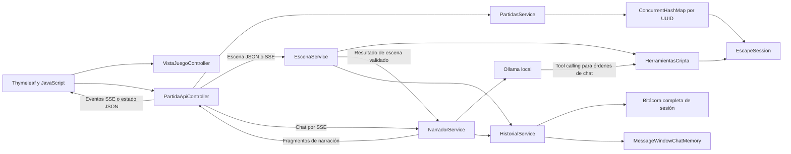

# Arquitectura y flujos

## Capas de la aplicación

- `config` publica un repositorio de memoria y una ventana Spring AI de 20 mensajes. `application.yaml` incluye el perfil `ollama` y desactiva el modelo de embeddings. `application-ollama.yaml` conecta Spring AI con `qwen3:8b` en `http://127.0.0.1:11434`, con descarga automática desactivada. El modelo debe estar instalado localmente.
- `controller` sirve las pantallas Thymeleaf y valida las solicitudes del navegador. Los endpoints de juego traducen sus resultados a JSON o SSE.
- `service` gestiona las sesiones por UUID, coordina las acciones de escena y la narración, y escribe los mensajes en las dos memorias.
- `tools` expone las operaciones del juego a Spring AI. Una instancia recibe la sesión de la petición desde Java y permite ejecutar una sola operación por turno. El modelo recibe argumentos de juego y el resultado narrativo de la operación.
- `model` aplica las reglas y guarda la vitalidad, los sellos, el inventario, la selección y las visitas. También genera el diagnóstico de forma determinista en ES o EN.
- `dto` contiene las instantáneas de estado y los resultados que consume el cliente. `exception` define el error HTTP 404 para sesiones desconocidas.

## Flujo de un turno

1. El navegador crea una sesión con el idioma elegido. El servidor asigna un UUID y entrega una instantánea inicial de la cripta. Reiniciar crea otra sesión y conserva la partida anterior para consultar su bitácora.
2. Una interacción de escena lleva un tipo y sus argumentos. Java ejecuta la regla una vez y emite el resultado validado en el primer fragmento. Mientras la partida siga en curso, Ollama puede añadir una frase ambiental. Esta petición breve lleva el idioma y el resultado del motor. El endpoint de escena síncrona ejecuta la misma regla y devuelve JSON.
3. Un mensaje de chat aporta al modelo la ventana reciente y el estado público de la cripta. Una orden explícita puede habilitar las herramientas de la sesión. Las consultas de significado y las explicaciones se envían sin herramientas. El comando `/diagnostico` lo resuelve Java con el informe pedagógico.
4. El controlador emite eventos SSE `texto` a medida que recibe los fragmentos. El evento final `estado` incluye el resultado validado, con la pista y el informe de cierre si proceden. La escena puede recuperar la instantánea mediante `GET /api/partidas/{sessionId}/estado`.
5. La bitácora guarda el mensaje escrito o la descripción de la acción y la respuesta del narrador. Cuando el turno termina en victoria o derrota, el motor genera el diagnóstico breve. La API ofrece el informe extenso bajo demanda.

El controlador usa un `SseEmitter` por turno con un tiempo de espera de 120 segundos y ejecuta la narración en un hilo virtual. La lectura de Ollama admite hasta 90 segundos entre fragmentos. Si el cliente cierra la conexión, el servidor deja de emitir al navegador. El cliente puede volver a consultar el estado y el historial por UUID.

## Concurrencia y retención

El mapa concurrente permite obtener o crear partidas de forma independiente. Cada sesión serializa sus turnos de chat, escena y cambio de idioma. El modelo sincroniza las operaciones de estado y entrega colecciones inmutables en la instantánea. El cerrojo de turno es independiente del cerrojo del motor para que una herramienta pueda ejecutarse desde el hilo del modelo mientras el turno sigue abierto.

La bitácora completa usa `CopyOnWriteArrayList<MensajeHistorial>`. Cada mensaje visible se registra también en `MessageWindowChatMemory` con el UUID de la partida y el respaldo de `InMemoryChatMemoryRepository`. La ventana aporta hasta veinte mensajes recientes al modelo. Spring AI gestiona los mensajes internos de herramientas dentro de la llamada al modelo. Las sesiones, sus bitácoras y sus ventanas residen en la memoria del proceso.

## Integración de la escena

Spring MVC sirve la portada y la partida mediante las plantillas Thymeleaf `inicio.html` y `juego.html`. El prototipo de `.codex-context/cripta-nocturnia-prototipo/` aporta la referencia visual. Los identificadores `altar`, `organ`, `chandelier` y `chest` enlazan los botones de escena con el motor. Al pulsarlos, el navegador envía una inspección o usa la reliquia seleccionada.

`cripta.js` usa `fetch` para enviar el JSON por POST y leer el cuerpo SSE. El evento `estado` actualiza vitalidad, sellos, lecturas, inventario y reacciones de los objetos. Si el flujo se interrumpe antes de ese evento, JavaScript consulta `/estado` para recuperar la instantánea. El botón de bitácora carga el historial y permite descargarlo como texto. Al finalizar, el botón del diagnóstico envía `/diagnostico` al chat.
